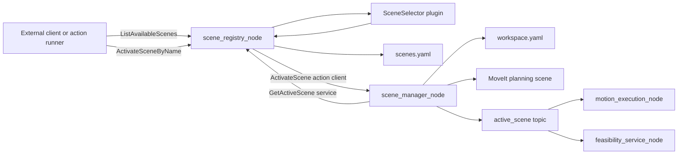
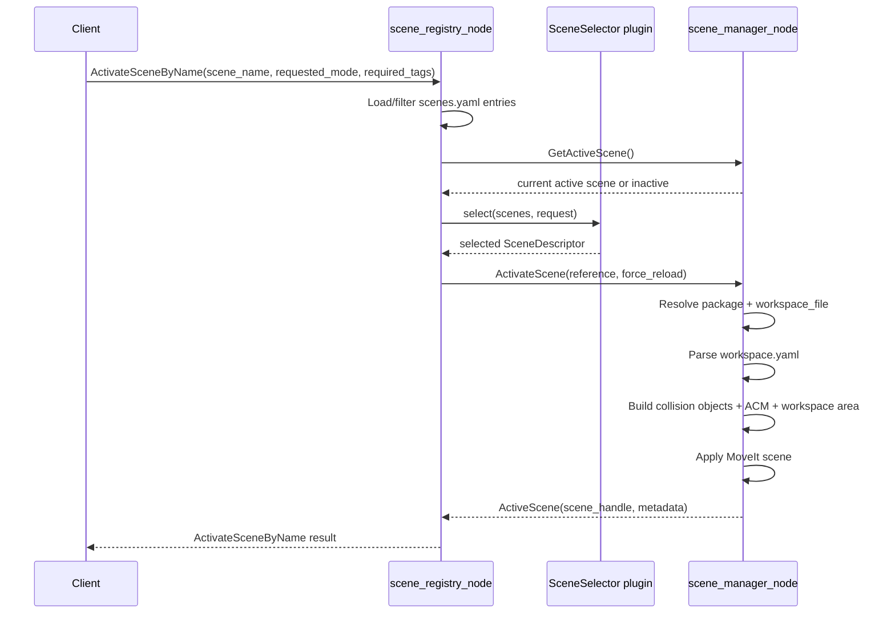
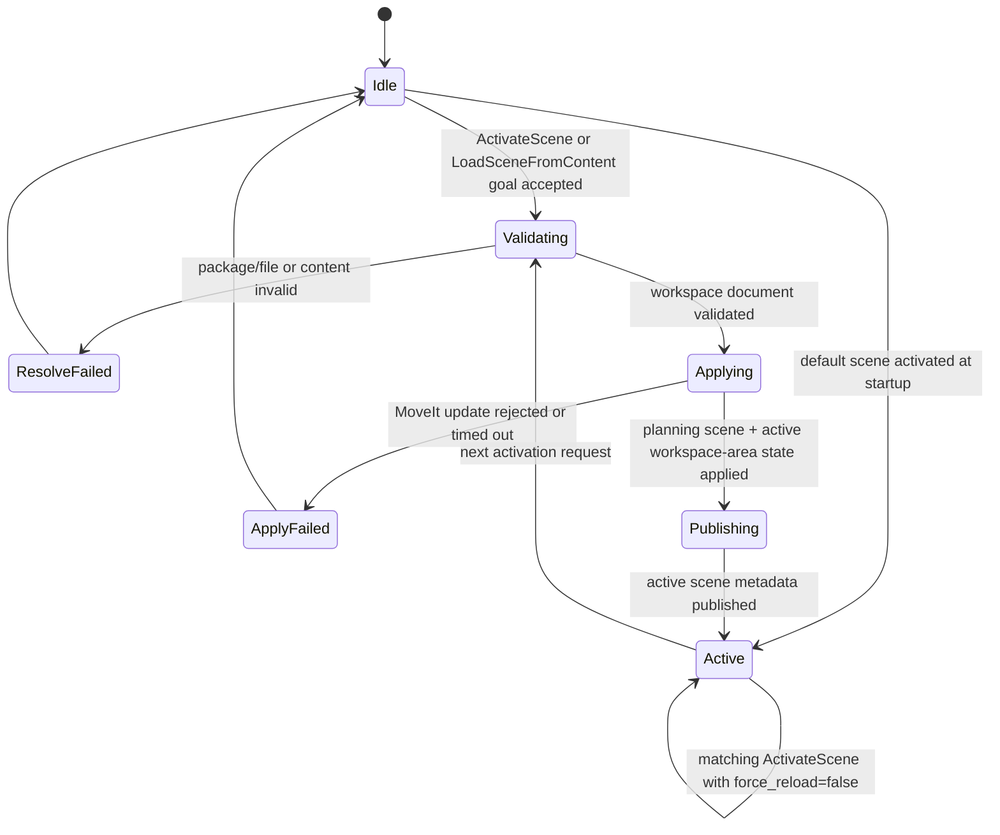
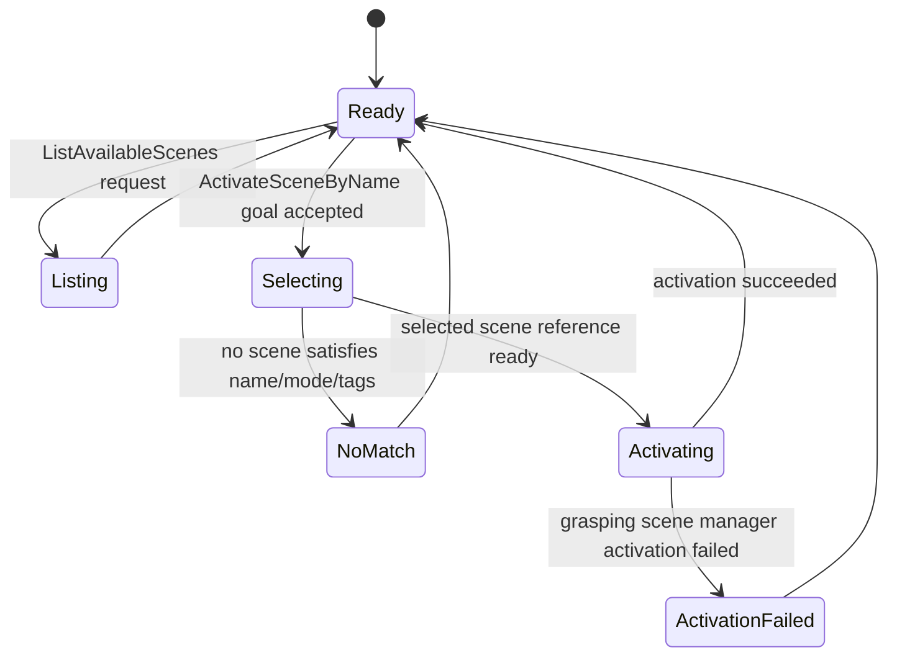

# Scene Management Architecture

This document describes the runtime interaction between the grasping-side scene manager and the mobile-manipulator-side scene registry.

## Status

The first integrated runtime is now in place:

- `scene_manager_node.py` is the grasping-side active-scene authority
- `scene_registry_node.cpp` loads `scenes.yaml`, hosts a `SceneSelector` plugin, and forwards `ActivateScene`
- `mobile_manipulator_scene_selector` provides the default `ExactNameThenTagsSelector`
- launch files now wire shared action, service, and topic names by default
- `scenes.yaml` currently contains a real `crlab_table` descriptor that points to the Omron workspace file

## API Diagram

## Scene Manager Runtime Sequence

## Scene Manager Node State Diagram

## Scene Registry Node State Diagram

## Active Scene Semantics

For the single-robot case, the active scene is a singleton global runtime state.

Rules:

- only one active scene exists at a time
- only one activation request may run at a time
- a successful activation fully replaces the previous active scene
- task execution must not implicitly change the active scene
- scene activation remains separate from `CheckTaskFeasibility`, `FindFeasiblePose`, and `ExecuteTaskPose`

## Grasping-Side Responsibilities

`scene_manager_node` is the only runtime authority for:

- parsing `workspace.yaml`
- deriving MoveIt collision objects
- applying allowed object-link collisions
- updating the active workspace-area filter
- publishing active-scene metadata

The existing arm execution and feasibility nodes should consume active-scene state, not own independent workspace parsing logic long term.

## Mobile-Manipulator-Side Responsibilities

`scene_registry_node` is responsible for:

- loading `scenes.yaml`
- exposing `ListAvailableScenes`
- exposing `ActivateSceneByName`
- hosting a `SceneSelector` plugin for selection policy
- querying `GetActiveScene` so selection can prefer reuse of the current scene
- calling the grasping-side `ActivateScene` action
- relaying the resulting `scene_handle` and active-scene metadata

The selector plugin itself is not the public ROS runtime surface.

## Current Launch Wiring

- `grasping_control/launch/motion_execution.launch.py` starts `scene_manager_node`, `motion_execution_node`, and `feasibility_service_node` with shared scene API names
- `mobile_manipulator_scene_registry/launch/scene_registry.launch.py` starts `scene_registry_node` with matching action and service names
- `mobile_manipulator_control/launch/mobile_manipulator_control.launch.py` now includes the scene-registry launch
- `grasping_omron_moma/launch/ld250_tm12x_soft_two_fingers.launch.py` bootstraps the default Omron `crlab_table` scene