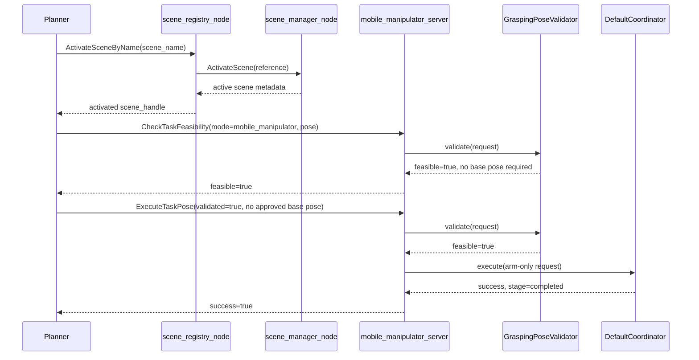
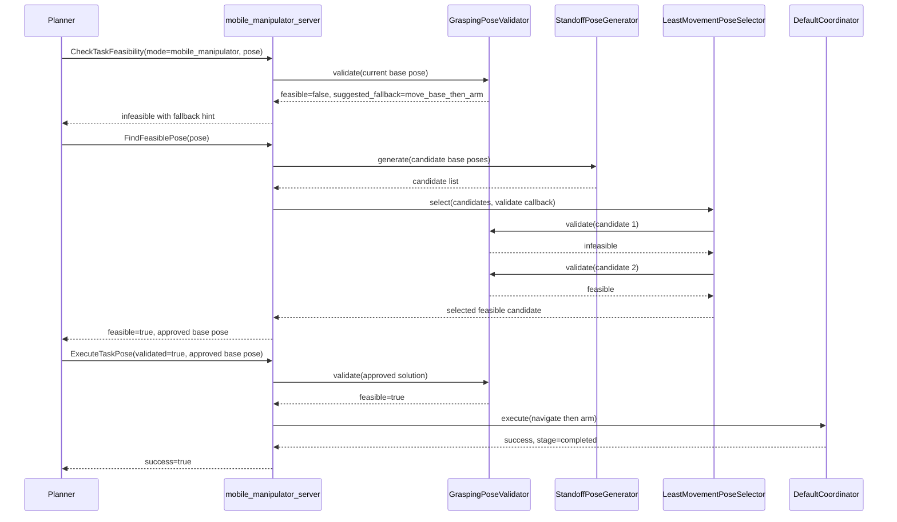

# Runtime Server

The `mobile_manipulator_ros` package provides the `mobile_manipulator_server` node.

## Responsibilities

The server owns three public ROS APIs:

| Responsibility area | Details |
| --- | --- |
| Public ROS APIs | `check_task_feasibility`, `find_feasible_pose`, `execute_task_pose` |
| Plugin loading | Loads validator, generator, selector, and coordinator through `pluginlib` |
| Parameter handling | Configures plugins through class-keyed parameter blocks |
| Result mapping | Converts internal validation and execution structures into ROS service and action responses |
| Safety guard | Revalidates approved solutions before execution |

## Plugin Loading Model

At startup the server:

1. Declares public ROS interface names
2. Reads plugin class parameters
3. Loads one validator, generator, selector, and coordinator
4. Derives the parameter prefix from each plugin class name
5. Calls `configure()` on each plugin

For example:

| Item | Example |
| --- | --- |
| Plugin class | `mobile_manipulator_pose_validator::GraspingPoseValidator` |
| Derived parameter prefix | `GraspingPoseValidator` |

## Service Flows

### `CheckTaskFeasibility`

The server builds a `PoseValidationRequest` from the ROS request and forwards it directly to the validator plugin.

Planner-facing interpretation:

- `feasible=true` means the current request can proceed without a base-search step
- `feasible=false` with `suggested_fallback=move_base_then_arm` means the planner should branch to `FindFeasiblePose` rather than treating the task as terminally impossible
- `failure_reason` is the machine-readable branch key; `message` is explanatory text only

### `FindFeasiblePose`

| Step | Behavior |
| --- | --- |
| 1 | Builds a `PoseValidationRequest` |
| 2 | Calls the generator plugin |
| 3 | Passes each candidate to the selector through a validation callback |
| 4 | Reuses the validator plugin for each candidate through that callback |
| 5 | Returns the selected feasible solution |

If no candidate succeeds, the server returns `failure_reason=no_feasible_candidate` and `suggested_fallback=move_base_then_arm`. That means the current default generator and selector policy did not find an approved base pose, not that scene activation or arm execution should be retried implicitly.

## Action Flow

### `ExecuteTaskPose`

| Step | Behavior |
| --- | --- |
| 1 | Rejects execution when `validated=false` |
| 2 | Revalidates the target and approved base pose through the validator plugin |
| 3 | Calls the coordinator plugin for motion |
| 4 | Publishes feedback stages while running |
| 5 | Returns the merged validation and execution result |

The runtime server now centralizes this result mapping so the public semantics for `failure_reason`, `suggested_fallback`, approved base-pose fields, and validation-guard failures stay consistent across feasibility, candidate search, and execution.

## Planner Examples

Example 1: direct arm-only success

1. Activate the correct scene through the mobile-manipulator scene registry.
2. Call `CheckTaskFeasibility` with `mode=mobile_manipulator`.
3. If `feasible=true`, continue directly to `ExecuteTaskPose` with `validated=true` and no approved base pose.

Example 2: arm-only infeasible but base move is suggested

1. Call `CheckTaskFeasibility`.
2. If `feasible=false` and `suggested_fallback=move_base_then_arm`, call `FindFeasiblePose`.
3. If `FindFeasiblePose` returns `feasible=true` and `base_target_pose_valid=true`, present or approve that candidate.
4. Call `ExecuteTaskPose` with `validated=true` plus the approved base pose returned by `FindFeasiblePose`.

Example 3: terminal failure for the current policy

1. Call `FindFeasiblePose`.
2. If the response returns `failure_reason=no_feasible_candidate`, treat that as failure of the current candidate-generation and selection policy.
3. Do not assume the scene should change or that execution should be attempted anyway without an explicit higher-level policy decision.

## Sequence Diagrams

### Arm-Only Success

### Base-Plus-Arm Fallback

## Current Default Plugin Chain

| Role | Plugin |
| --- | --- |
| Validator | `GraspingPoseValidator` |
| Generator | `StandoffPoseGenerator` |
| Selector | `LeastMovementPoseSelector` |
| Coordinator | `DefaultCoordinator` |

## Launch Surface

The generic launch entry point is `mobile_manipulator_ros/launch/task_feasibility.launch.py`.

It starts one node:

| Launch file | Starts | Overridable argument |
| --- | --- | --- |
| `mobile_manipulator_ros/launch/task_feasibility.launch.py` | `mobile_manipulator_server` | `config_file` |

This allows platform wrappers to inject their own parameter YAML without copying the node definition.
